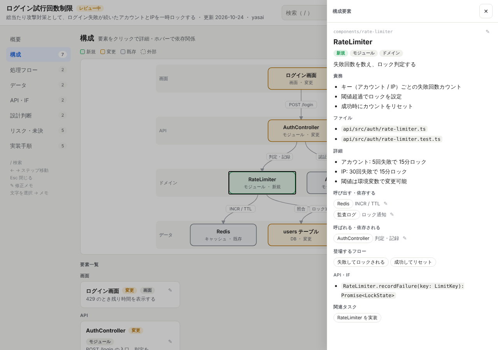

# design-viewer

コーディング作業の設計情報を、クリックで詳細を掘れる単一の HTML にまとめる Claude スキルです。

- 設計は JSON に書く。HTML・CSS・JS は書かない（表示はテンプレートが担当）
- 最初は目的と要点だけ。詳細は折りたたみ・クリックで開く
- Sonnet でも動くよう、手順・スキーマ・検証を固定している



## できること

| 画面 | 内容 |
|---|---|
| 概要 | 目的 1 文、要点 3 つ、件数タイル |
| 要件 | EARS 形式の要件。パターン別バッジ、キーワード強調、検証するシナリオへのリンクと検証率 |
| 構成 | 新規・変更・既存を色分けした構成図。ホバーで依存関係、クリックで詳細パネル |
| 処理フロー | シーケンス図。← → キーで 1 ステップずつ進む |
| データ | エンティティ、フィールド、関連 |
| API・IF | リクエスト、レスポンス、エラー |
| 設計判断 | 採用案、理由、検討した案の長所・短所 |
| テスト | Gherkin のシナリオ（日本語・英語）。Given/When/Then の色分け、Outline の例表、データ表、`.feature` 用テキスト |
| リスク・未決 | 重要度順のリスク、解決済みにできる未決事項 |
| 実装手順 | 依存関係つきタスク、チェックで進捗表示 |

検索（`/` キー）、ダークモード、スマホ幅に対応しています。

## 修正を繰り返しやすくする仕組み

ブラウザで確認して修正を頼むとき、Claude が毎回ファイル全体を読み書きしないための機能です。

- **修正メモ**: 直したい文字を選択すると「この箇所にメモ」が出る。各カードの ✎ からも書ける
- **修正依頼のコピー**: 右上の「修正依頼」→「コピー」で、場所（path）付きのテキストになる
  ```
  - components/rate-limiter/detail（RateLimiter）: 「30回失敗」→ 20回に
  ```
- **部分編集**: `scripts/edit.js` が path を指定して必要な箇所だけ読む・直す。保存すると HTML も自動で作り直す
- 場所が書かれていない普通の文章の依頼も、`find` で場所を探して対応する

## 使い方

Node.js 18 以上が必要です（追加のインストールは不要）。

1. このフォルダをスキルとして配置する
   - Claude Code: `~/.claude/skills/design-viewer/`（プロジェクト単位なら `.claude/skills/design-viewer/`）
   - claude.ai: スキル設定から、このフォルダを zip にしてアップロード
2. 設計を頼む（例: 「ログイン試行回数制限の設計を design-viewer で出して」）
3. Claude が `docs/design/<名前>.design.json` を書き、HTML を生成する
4. HTML をブラウザで開いて確認し、直したい所はメモして Claude に貼り付ける

手動で生成する場合:

```
node scripts/build.js docs/design/x.design.json
node scripts/edit.js docs/design/x.design.json outline
node scripts/edit.js docs/design/x.design.json find 閾値
node scripts/edit.js docs/design/x.design.json set components/rate-limiter/summary "新しい要約"
```

## 構成

```
design-viewer/
├── SKILL.md                  Claude 向けの手順と書き方ルール
├── assets/viewer.html        表示テンプレート（編集しない）
├── scripts/build.js          JSON を検証して HTML に埋め込む
├── scripts/edit.js           JSON の部分読み書き（outline / find / get / set / add / rm / rename / apply）
├── references/schema.md      JSON の項目一覧
└── examples/                 サンプル（ログイン試行回数制限）
```

サンプルの出力は [`examples/login-rate-limit.html`](examples/login-rate-limit.html) をブラウザで開くと確認できます。

## 制限

- 修正メモと、タスク・未決事項のチェックは、見ているブラウザにだけ保存される（共有されない）
- 構成図は段（layer）ごとの自動配置。1 段 6 個、1 フロー 12 ステップを超えると読みにくくなる（`build.js` が警告する）
